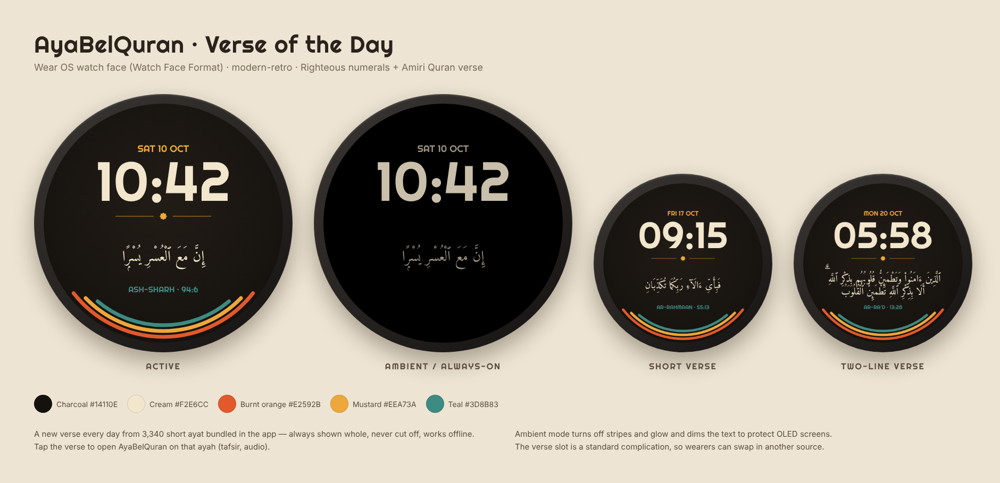

# AyaBelQuran

Simple Wear OS app to pull a verse with audio

## Verse of the Day watch face

- `app/.../complication/VerseComplicationService.kt` is a complication data source
  ("Verse of the Day", `LONG_TEXT` + `SHORT_TEXT`). It picks one verse per day from
  `app/src/main/res/raw/glance_verses.tsv`: the 3,340 ayat of 100 characters or fewer,
  so the verse is always shown whole and works offline. Tapping opens the app on that ayah.
- `watchface/` is a [Watch Face Format](https://developer.android.com/training/wearables/wff)
  package (resources only, `hasCode=false`, WFF v1 / Wear OS 4+). Its verse slot defaults to
  the app's complication and falls back to a fixed verse (94:6) if the app isn't installed.
  It's published as its own Play listing (`com.raibbl.ayabelquran.watchface`).
- Fonts: [Righteous](watchface/licenses/Righteous-OFL.txt) and
  [Amiri Quran](watchface/licenses/AmiriQuran-OFL.txt), both SIL OFL.
- Quran text: Tanzil Uthmani via alquran.cloud.

Validate the watch face with Google's [WFF validator](https://github.com/google/watchface):
`java -jar wff-validator.jar 1 watchface/src/main/res/raw/watchface.xml`
